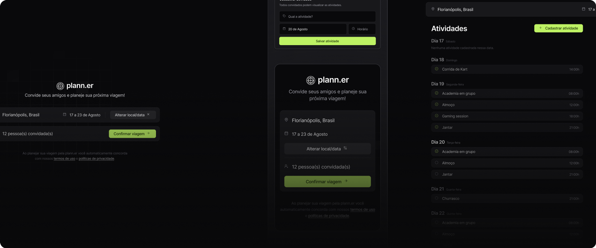

<h1 align="center"> plann.er - NLW Journey ✈️</h1>

API para planejar viagens com convidados, confirmação por e-mail, atividades e links

  <a href="#-tecnologias">Tecnologias</a>&nbsp;&nbsp;&nbsp;|&nbsp;&nbsp;&nbsp;
  <a href="#-projeto">Projeto</a>

  
 

## 🚀 Tecnologias

Esse projeto foi desenvolvido com as seguintes tecnologias:

- Python
- Flask
- SQLite
- SMTP (e-mails de teste com Ethereal)
- Pytest
- Git e Github

## 💻 Projeto

- O plann.er é a API do NLW Journey da Rocketseat para organizar viagens a trabalho ou lazer. O criador cadastra a viagem com destino, datas e e-mails dos convidados e recebe um e-mail para confirmá-la; com a viagem confirmada, os convidados recebem o convite, confirmam presença e todos podem adicionar atividades com data e horário e links importantes, como reservas e locais para visitar.

- A API é organizada em camadas: rotas Flask, controllers para cada caso de uso (criar, buscar e confirmar viagens, participantes, atividades e links), repositórios com SQL direto sobre SQLite (schema em `init/`) e um driver de envio de e-mail via SMTP, que usa uma conta de testes do Ethereal criada pelo `create_email.py`.

<h2 align="center">📌 Desenvolvedores</h2>

<table align="center">
  <tr>
    <td align="center">
      <a href="https://github.com/rebellatoGui" title="GitHub">
         
        
          <b>Guilherme Rebellato</b>
        
      </a>
    </td>
  </tr>
</table>

 

---

Feito com ♥ por rebellatoGui

